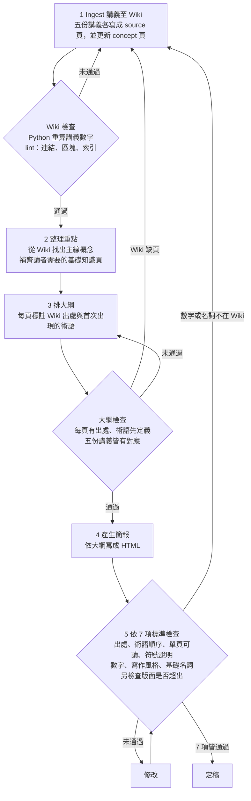

# Loop／Graph 設計

## 流程圖

文字版：Ingest 講義至 Wiki → 整理重點 → 排大綱 → 產生簡報 → 依 7 項標準檢查 → 未通過則修改並重新檢查 → 定稿

## 各節點說明

| 節點 | 輸入 | 輸出 | 檢查 |
|---|---|---|---|
| 1 Ingest 講義至 Wiki | 講義 PDF | source 頁、concept 頁、log | 以 Python 重算講義數字；`tools/lint_wiki.py` |
| 2 整理重點 | Wiki | 主線概念、基礎知識頁、`docs/01-requirements.md` | 基礎知識頁同樣通過 lint |
| 3 排大綱 | Wiki | `docs/02-outline.md` | 每頁有出處、術語先定義後使用、五份講義皆有對應 |
| 4 產生簡報 | 大綱、Wiki | `src/slides.src.html`、`index.html` | — |
| 5 檢查 | 簡報 | `logs/check-round1..4.txt` | `tools/check_slides.py` 7 項檢查；逐頁截圖量測版面 |

## 哪些步驟重複執行

1. **Ingest loop**：五份講義各跑一次「ingest → 檢查」，未通過即修改後重跑。
2. **檢查 loop**：「檢查 → 修改 → 重新檢查」，直到 7 項皆通過。實際共 4 輪：第一輪 19 頁中 14 頁有內容問題，第二輪全部通過；之後新增基礎名詞檢查，第三輪 6 頁未通過，第四輪全部通過後定稿。
3. **退回 Wiki**：排大綱或檢查時發現 Wiki 缺資料，退回節點 1 補頁，再往下重跑。實際發生兩次：補上自然對數、報酬率、測度三個基礎名詞，以及圖上 5 個不在 Wiki 的數字。

## 哪些地方需要檢查或重新生成

- **數字**：講義數字於 ingest 時重算，抓到講義 3 處錯誤；簡報數字須能在對應的 Wiki 頁面找到，防止自行算出或編造數字。
- **術語順序、符號說明與基礎名詞**：讀者沒有基礎，任何術語或符號在說明前出現，該頁就看不懂，故逐頁檢查；基礎名詞以 Wiki 的基礎知識頁為準，出現即須連到對應頁面。
- **大綱對 Wiki 的覆蓋**：產生內容前先確認每頁都有出處，缺頁時退回 Wiki 補頁，而非在簡報中自行補寫。
- **版面**：內容正確但超出版面或圖被切掉，讀者同樣無法閱讀，須以截圖檢查。

## 為什麼這樣設計

- **錯誤越晚發現，修改的範圍越大**。若到簡報完成才發現缺少「無套利」的定義，須同時修改 Wiki、大綱與多頁簡報；在大綱階段發現，只需補一頁 Wiki。故每個節點都設檢查，且檢查盡量往前放。
- **檢查寫成腳本**。出處、數字、符號、術語順序皆寫成程式，每次修改後都能重跑，4 輪檢查的結果皆存於 `logs/`，可回頭比對每輪修了什麼。腳本無法判斷的「初學者看不看得懂」，則以逐頁閱讀補足。
- **指回節點 1 的箭頭**：簡報的品質取決於 Wiki 的品質，簡報階段發現的知識缺口須回到 Wiki 補齊，補進 Wiki 的內容之後也能重複使用。
