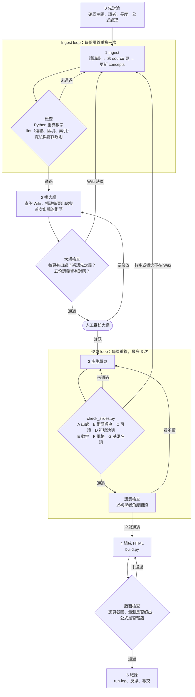

# Loop／Graph 設計

## 流程圖

## 各節點說明

| 節點 | 輸入 | 輸出 | 檢查 |
|---|---|---|---|
| 0 先討論 | 作業要求 | `docs/01-requirements.md` | 人工確認範圍、讀者、長度 |
| 1 Ingest | 講義 PDF | source 頁、concept 頁、log | 以 Python 重算講義數字；`tools/lint_wiki.py`；CLAUDE.md 的隱私與寫作規則 |
| 2 排大綱 | Wiki | `docs/02-outline.md` | 每頁有出處、術語先定義後使用、五份講義皆有對應；人工審核 |
| 3 逐頁產生 | 大綱、Wiki | `src/slides.src.html` | `tools/check_slides.py` 七項檢查；語意檢查 |
| 4 組成 HTML | 原稿 | `index.html` | 逐頁截圖、量測超出版面、KaTeX 錯誤 |
| 5 紀錄 | 各節點紀錄 | `run-log.md`、反思 | — |

## 哪些步驟重複執行

1. **Ingest loop**：五份講義各跑一次「ingest → 檢查」，檢查未通過即修改後重跑。
2. **逐頁 loop**：每頁「產生 → 檢查 → 修改」，同一頁最多重做 3 次；仍不通過代表問題不在寫法，而在 Wiki 缺資料，須退回節點 1。
3. **版面 loop**：「組裝 → 截圖 → 調整」，直到所有頁面不超出版面。

## 哪些地方需要檢查或重新生成

- **數字**：講義數字在 ingest 時重算；簡報數字須能在對應的 Wiki 頁面找到。兩道檢查分別防止「講義本身有錯」與「AI 自行算出或編造數字」。
- **術語順序、符號說明與基礎名詞**：讀者沒有基礎，任何術語或符號在說明前出現，該頁就看不懂，故逐頁檢查；基礎名詞以 Wiki 的基礎知識頁為準，出現即須連到對應頁面。
- **大綱對 Wiki 的覆蓋**：產生內容前先確認每頁都有出處；缺頁時退回 Wiki 補頁，而非在簡報中自行補寫。
- **版面**：內容正確但超出版面或圖被切掉，讀者同樣無法閱讀，須以截圖檢查。

## 為什麼這樣設計

- **錯誤越晚發現，修改的範圍越大**。若到 HTML 完成才發現缺少「無套利」的定義，須同時修改 Wiki、大綱與多頁簡報；在大綱階段發現，只需補一頁 Wiki。因此每個節點都設檢查，且檢查盡量往前放。
- **能寫成規則的交給腳本，需要判斷的交給人**。出處、數字、符號、術語順序可寫成程式，每次修改後都能重跑；「初學者看不看得懂」無法寫成規則，故保留語意檢查與大綱的人工審核。
- **逐頁而非一次產生全部**。一次產生 15 頁時，錯誤混在一起，無法得知錯在哪一頁、哪一項；逐頁檢查可精確定位，失敗紀錄也可回頭用來修改流程。
- **指回節點 1 的箭頭（「Wiki 缺頁」「數字或概念不在 Wiki」）**：簡報的品質取決於 Wiki 的品質，簡報階段發現的知識缺口須回到 Wiki 補齊，補進 Wiki 的內容之後也能重複使用。
